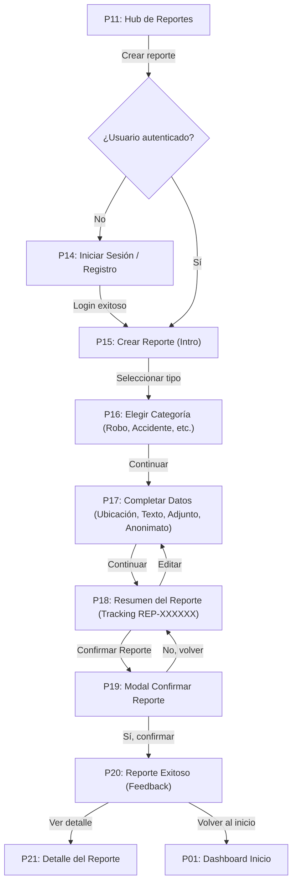
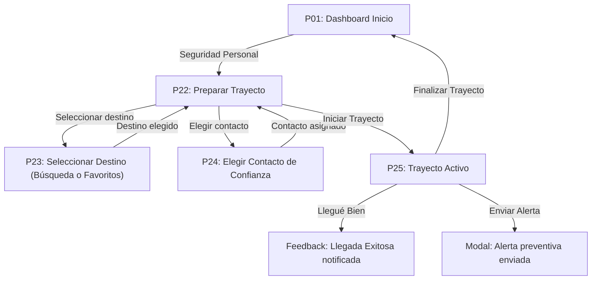
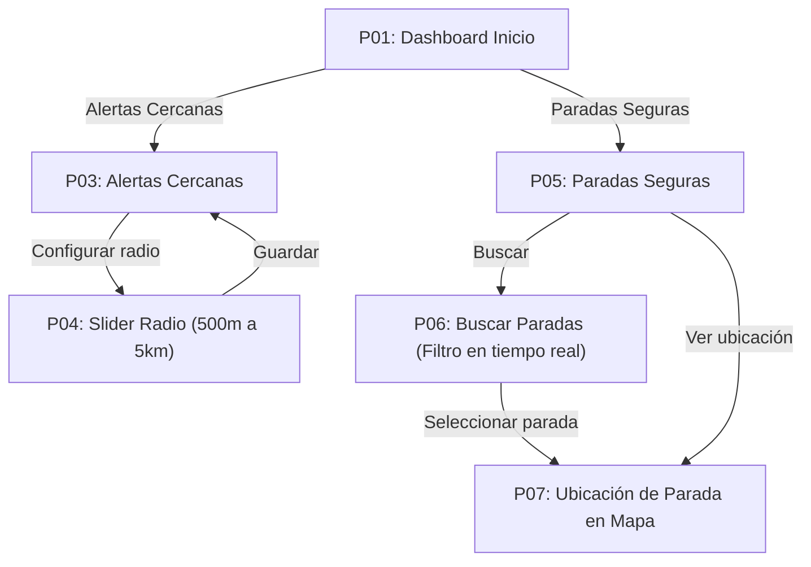
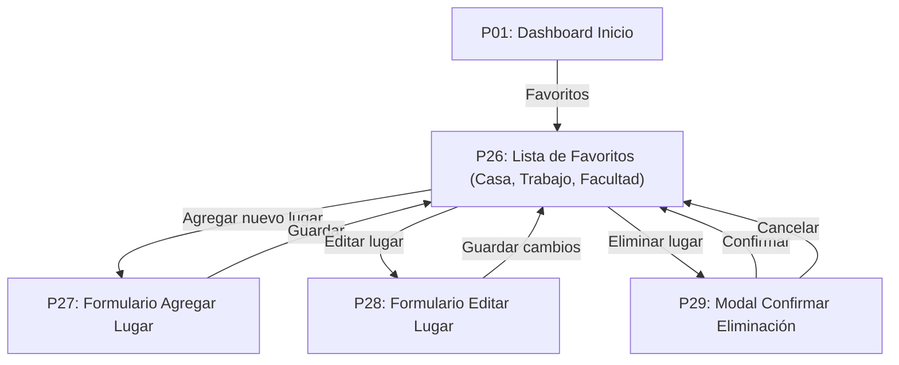

# USER_FLOWS.md: Recorridos de Usuario y Navegación

Este documento modela los recorridos funcionales principales y las transiciones entre las 41 pantallas de "Alerta Vecinos".

---

## 1. Recorrido Principal: Crear y Gestionar Reporte (Wizard de 7 pasos)



---

## 2. Recorrido de Seguridad Personal: "Llegué Bien"



---

## 3. Recorrido de Consulta: Paradas Seguras y Radio



---

## 4. Recorrido de Favoritos y Lugares Frecuentes



---

## 5. Recorrido de Administración y Moderación

```mermaid
flowchart TD
    P01["P01: Dashboard Inicio"] -->|Administración (Badge Privilegiado)| P37["P37: Hub de Administración"]
    P37 -->|Moderación| P38["P38: Moderar Reportes (Aprobar / Rechazar)"]
    P37 -->|Estadísticas| P39["P39: Estadísticas (KPIs y Gráficos)"]
    P37 -->|Gestión Usuarios| P40["P40: Gestión de Usuarios (Activar / Bloquear)"]
    P37 -->|Gestión Reportes| P41["P41: Gestión Global de Reportes (Filtros y Resolución)"]
    P38 -->|Aprobar/Rechazar| P38
    P41 -->|Ver detalle| P21["P21: Detalle del Reporte"]
```
