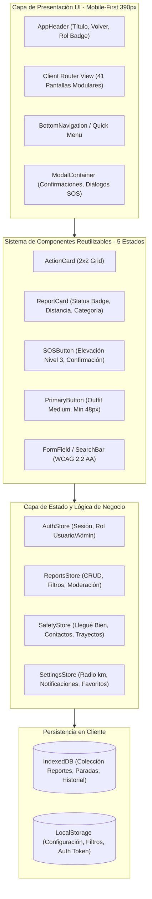

# Arquitectura del Sistema: Alerta Vecinos

## 1. Visión y Propósito
"Alerta Vecinos" es una aplicación web progresiva (PWA / SPA) de seguridad comunitaria y protección mutua vecinal en Argentina. Su objetivo es brindar a los ciudadanos herramientas rápidas, accesibles e intuitivas para reportar incidentes, monitorear paradas seguras, configurar zonas de alerta, realizar trayectos acompañados ("Llegué Bien") y gestionar la seguridad barrial con moderación comunitaria.

## 2. Principios de Arquitectura Técnica
- **Arquitectura de Aplicación:** Single Page Application (SPA) con arquitectura basada en componentes modulares, reactiva y ultra-ligera.
- **Herramientas de Construcción y Tipado:** Vite + TypeScript estricto.
- **Estilos y Sistema Visual:** Tailwind CSS configurado con los tokens semánticos oficiales de `DESIGN.md`, fuentes Google Fonts (`Outfit` para títulos y jerarquía visual, `Inter` para legibilidad técnica y formularios).
- **Manejo de Estado del Cliente:** Store reactivo desacoplado con Observer/Event-driven pattern en TypeScript.
- **Persistencia en Cliente:** `LocalStorage` para configuración de usuario, filtros, sesión simulada y preferencias; `IndexedDB` para colecciones estructuradas de reportes, alertas, paradas y registros históricos.
- **Enrutamiento:** Hash-based client router (`#inicio`, `#mapa-riesgo`, `#reportes`, `#seguridad-personal`, etc.) para máxima portabilidad estática y compatibilidad total sin dependencias de servidor.
- **Diseño Mobile-First:** Viewport de referencia 390px, márgenes de 16px, grilla de 4 columnas, zonas de pulgar ergonómicas (Thumb Zone de 120px a 360px) y adaptación fluida a tablet/desktop.

## 3. Diagrama de Arquitectura de Capas



## 4. Estructura del Proyecto Frontend
```text
alerta-vecinos/
├── src/
│   ├── assets/              # Iconos SVG y recursos gráficos
│   ├── components/          # Componentes reutilizables con los 5 estados
│   │   ├── common/          # Botones, Badges, Modales, Inputs, Headers
│   │   ├── cards/           # ActionCard, ReportCard, AlertCard, StopCard
│   │   └── navigation/      # AppHeader, BottomNav, QuickMenu
│   ├── modules/             # Vistas de las 41 pantallas agrupadas por dominio
│   │   ├── inicio/          # Pantallas 1-10 (Dashboard, Mapa, Paradas, Alertas)
│   │   ├── reportes/        # Pantallas 11-21 (Creación paso a paso, Lista, Detalle)
│   │   ├── seguridad/       # Pantallas 22-25 (Llegué Bien, Contactos, Trayecto)
│   │   ├── favoritos/       # Pantallas 26-29 (CRUD lugares seguros)
│   │   ├── perfil/          # Pantallas 30-36 (Perfil, Notificaciones, Historial)
│   │   └── admin/           # Pantallas 37-41 (Moderación, Estadísticas, Usuarios)
│   ├── router/              # Enrutador cliente SPA hash-based
│   ├── state/               # Stores reactivos de datos y persistencia
│   ├── styles/              # Variables CSS de DESIGN.md y Tailwind setup
│   ├── types/               # Tipos e interfaces TypeScript estrictas
│   └── main.ts              # Punto de entrada de la aplicación
├── docs/                    # Documentación y contexto del sistema
├── DESIGN.md                # Sistema de diseño de referencia
└── index.html               # Entry point HTML5 semántico
```
